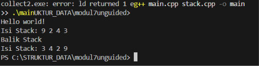
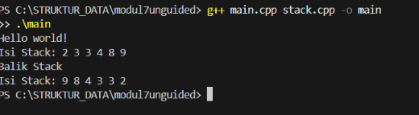
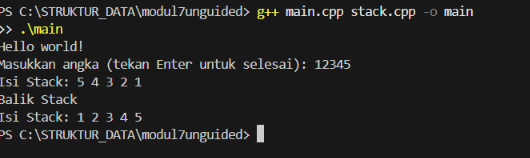

# <h1 align="center">Laporan Praktikum Modul 7 - Codeblocks IDE & Pengenalan Bahas C++ (Bagian Pertama)</h1>

<p align="center">Ewaldo Ardiansyah Widyadhana - 109082500008</p>

## Dasar Teori

Stack merupakan salah satu bentuk struktur data yang menggunakan prinsip LIFO (Last In First Out), yaitu data yang terakhir dimasukkan akan menjadi data pertama yang dikeluarkan. Stack memiliki bentuk seperti tumpukan, sehingga proses penambahan dan pengambilan data hanya dilakukan pada satu bagian, yaitu bagian atas yang disebut TOP.

Dalam struktur data Stack, terdapat dua operasi utama, yaitu Push dan Pop. Push merupakan operasi untuk menambahkan elemen baru ke dalam tumpukan, sedangkan Pop merupakan operasi untuk mengambil atau menghapus elemen yang berada di posisi paling atas.

Pada latihan 7.6, Stack diimplementasikan menggunakan Array dengan kapasitas sebanyak 20 elemen bertipe integer. Stack memiliki variabel top yang digunakan untuk menunjukkan jumlah elemen yang tersimpan sekaligus menentukan posisi elemen paling atas. Ketika stack kosong, nilai top adalah 0.

Selain operasi dasar tersebut, latihan ini juga menggunakan beberapa prosedur tambahan, yaitu printInfo() untuk menampilkan seluruh isi stack, balikStack() untuk membalik urutan elemen, pushAscending() untuk memasukkan data secara terurut, serta getInputStream() untuk menerima masukan angka dari pengguna hingga menekan tombol Enter.

## Guided 1(stack dengan array)

### 1. Header stack

```C++
#ifndef STACK
#define STACK
#define Nil NULL
#include <iostream>
using namespace std;
typedef struct node *address;

struct node
{
    int dataAngka;
    address next;
};

struct stack
{
    address top;
};

bool isEmpty(stack listStack);
void createStack(stack &listStack);
address alokasi (int angka);
void dealokasi(address &node);

void push(stack &listStack, address nodeBaru);
void pop(stack &listStack);
void update(stack &listStack, int posisi);
void view(stack listStack);
void searchData(stack listStack, int data);

#endif
```


### 2. Code Utama

```C++
#include "stack.h"

bool isEmpty(stackTable s)
{
    return s.top == -1;
}
bool isFull(stackTable s)
{
    return s.top == MAX-1;
}
void createStack(stackTable &s)
{
    s.top = -1;
}
void push(stackTable &s, int angka)
{

    if (isFull(s))
    {
        cout<< "Stack penuh!"<< endl;
    }
    else
    {
        s.top++;
        s.data[s.top] = angka;
        cout<<"Data "<< angka<< " berhasil ditambahkan kedalam stack !"<< endl;
    }
}
void pop(stackTable &s)
{
    if (isEmpty(s))
    {
        cout<< "Stack kosong!"<< endl;
    }
    else
    {
        int val = s.data[s.top];
        s.top--;
        cout<<"Data "<< val << " berhasil dihapus dari stack !"<< endl;
    }
}
void update(stackTable &s, int posisi)
{
    if(isEmpty(s))
    {
        cout<< "Stack kosong!"<< endl;
    }
    if (posisi <=0)
    {
        cout<< "Posisi tidak valid"<< endl;
        return;
    }
    // inndex = top

    int idx = s.top - (posisi -1);
    if(idx < 0 || idx > s.top)
    {
        cout<<"Posisi "<< posisi<< " tidak valid!"<< endl;
        return;
    }
    
    cout<<"Update data posisi ke-"<< posisi<<endl;
    cout << "Masukkan angka : ";
    cin >> s.data[idx];
    cout << "Data berhasil diupdate!" << endl;
    cout << endl;
}
void view(stackTable s)
{
    if (isEmpty(s))
    {
        cout<< "Stack Kosong!"<<endl;
    }
    else
    {
        for (int i = s.top; i>= 0; --i)
        {
            cout<< s.data[i]<< " ";
        }
    }
    cout << endl;
}
void searchData(stackTable s, int data)
{
    if (isEmpty(s))
    {
        cout << "Stack kosong!" << endl;
        return;
    }

    cout << "Mencari data " << data << "..." << endl;
    int posisi = 1;
    bool found = false;

    for (int i = s.top; i >= 0; --i)
    {
        if (s.data[i] == data)
        {
            cout << "Data " << data << " ditemukan pada posisi ke-" << posisi << endl;
            cout << endl;
            found = true;
            break;
        }
        posisi++;
    }

    if (!found)
    {
        cout << "Data " << data << " tidak ditemukan didalam stack!" << endl;
        cout << endl;
    }
}
```

### 3. main.cpp

```C++
#include "stack.h"
#include <iostream>

using namespace std;

int main()
{
    stackTable s;
    createStack(s);

    push(s, 1);
    push(s, 2);
    push(s, 3);
    push(s, 4);
    push(s, 5);
    cout << endl;

    cout << "--- Stack setelah push ---" << endl;
    view(s);
    cout << endl;

    pop(s);
    pop(s);
    cout << endl;

    cout << "--- Stack setelah pop 2 kali ---" << endl;
    view(s);
    cout << endl;

    update(s, 2);
    update(s, 1);
    cout << endl;

    cout << "--- Stack setelah update ---" << endl;
    view(s);
    cout << endl;

    searchData(s, 4);
    searchData(s, 9);

    return 0;
}
```
## guided 2 (Stack dengan Linked List)

## 1.Header stack

```C++
#ifndef STACK
#define STACK
#define Nil NULL
#include <iostream>
using namespace std;
typedef struct node *address;

struct node
{
    int dataAngka;
    address next;
};

struct stack
{
    address top;
};

bool isEmpty(stack listStack);
void createStack(stack &listStack);
address alokasi (int angka);
void dealokasi(address &node);

void push(stack &listStack, address nodeBaru);
void pop(stack &listStack);
void update(stack &listStack, int posisi);
void view(stack listStack);
void searchData(stack listStack, int data);

#endif
```

## 2.Code Utama stack

```C++
#include "stack.h"
#include <iostream>

using namespace std;

bool isEmpty(stack listStack)
{
    if (listStack.top == Nil)
    {
        return true;
    }
    else
    {
        return false;
    }
}

void createStack(stack &listStack)
{
    listStack.top = Nil;
}

address alokasi(int angka)
{
    address nodeBaru = new node;
    nodeBaru->dataAngka = angka;
    nodeBaru->next = Nil;
    return nodeBaru;
}

void dealokasi(address &node)
{
    node->next = Nil;
    delete node;
}

void push(stack &listStack, address nodeBaru)
{
    nodeBaru->next = listStack.top;
    listStack.top = nodeBaru;
    cout << "Node " << nodeBaru->dataAngka << " berhasil ditambahkan kedalam stack!" << endl;
}

void pop(stack &listStack)
{
    address nodeHapus;
    if (isEmpty(listStack) == true)
    {
        cout << "Stack kosong!" << endl;
    }
    else
    {
        nodeHapus = listStack.top;
        listStack.top = listStack.top->next;
        nodeHapus->next = Nil;
        dealokasi(nodeHapus);
        cout << "node " << nodeHapus->dataAngka << " berhasil dihapus dari stack!" << endl;
    }
}

void update(stack &listStack, int posisi)
{
    if (isEmpty(listStack) == true)
    {
        cout << "Stack kosong!" << endl;
    }
    else
    {
        if (posisi == 0)
        {
            cout << "Posisi tidak valid!" << endl;
        }
        else
        {
            address nodeBantu = listStack.top;
            int count = 1;
            bool found = false;
            while (nodeBantu != Nil)
            {
                if (count < posisi)
                {
                    nodeBantu = nodeBantu->next;
                    count++;
                }
                else if (count == posisi)
                {
                    cout << "Update node poisisi ke-" << posisi << endl;
                    cout << "Masukkan angka : ";
                    cin >> nodeBantu->dataAngka;
                    cout << "Data berhasil diupdate!" << endl;
                    cout << endl;
                    found = true;
                    break;
                }
            }
            if (found == false)
            {
                cout << "Posisi " << posisi << " tidak valid!" << endl;
            }
        }
    }
}

void view(stack listStack)
{
    if (isEmpty(listStack) == true)
    {
        cout << "List kosong!" << endl;
    }
    else
    {
        address nodeBantu = listStack.top;
        while (nodeBantu != Nil)
        {
            cout << nodeBantu->dataAngka << " ";
            nodeBantu = nodeBantu->next;
        }
    }
    cout << endl;
}

void searchData(stack listStack, int data)
{
    if (isEmpty(listStack) == true)
    {
        cout << "List kosong!" << endl;
    }
    else
    {
        address nodeBantu = listStack.top;
        int posisi = 1;
        bool found = false;
        cout << "Mencari data " << data << "..." << endl;
        while (nodeBantu != Nil)
        {
            if (nodeBantu->dataAngka == data)
            {
                cout << "Data " << data << " ditemukan pada posisi ke-" << posisi << endl;
                found = true;
                cout << endl;
                break;
            }
            else
            {
                posisi++;
                nodeBantu = nodeBantu->next;
            }
        }
        if (found == false)
        {
            cout << "Data " << data << " tidak ditemukan didalam stack!" << endl;
            cout << endl;
        }
    }
}
```

## 3.Main stack

```C++
#include "stack.h"
#include <iostream>

using namespace std;

int main()
{
    stack listStack;
    address nodeA, nodeB, nodeC, nodeD, nodeE = Nil;
    createStack(listStack);

    nodeA = alokasi(1);
    nodeB = alokasi(2);
    nodeC = alokasi(3);
    nodeD = alokasi(4);
    nodeE = alokasi(5);

    push(listStack, nodeA);
    push(listStack, nodeB);
    push(listStack, nodeC);
    push(listStack, nodeD);
    push(listStack, nodeE);
    cout << endl;

    cout << "--- Stack setelah push ---" << endl;
    view(listStack);
    cout << endl;

    pop(listStack);
    pop(listStack);
    cout << endl;

    cout << "--- Stack setelah pop 2 kali ---" << endl;
    view(listStack);
    cout << endl;

    update(listStack, 2);
    update(listStack, 1);
    update(listStack, 4);
    cout << endl;

    cout << "--- Stack setelah update ---" << endl;
    view(listStack);
    cout << endl;

    searchData(listStack, 4);
    searchData(listStack, 9);

    return 0;
}
```

## Unguided

### 1. header satck
header satck

```C++

#ifndef STACK_H
#define STACK_H

typedef int infotype;

struct Stack {
    infotype info[20];
    int top;
};

void createStack(Stack &S);
void push(Stack &S, infotype x);
infotype pop(Stack &S);
void printInfo(Stack S);
void balikStack(Stack &S);
void pushAscending(Stack &S, infotype x);
void getInputStream(Stack &S);

#endif

```
## 2. code utama stack

```C++

#include <iostream>
#include "stack.h"
using namespace std;

void createStack(Stack &S) {
    S.top = 0;
}

void push(Stack &S, infotype x) {
    if (S.top < 20) {
        S.top++;
        S.info[S.top - 1] = x;
    } else {
        cout << "Stack penuh!" << endl;
    }
}

infotype pop(Stack &S) {
    if (S.top > 0) {
        infotype x = S.info[S.top - 1];
        S.top--;
        return x;
    }

    cout << "Stack kosong!" << endl;
    return -1;
}

void printInfo(Stack S) {
    if (S.top == 0) {
        cout << "Stack kosong!" << endl;
        return;
    }

    cout << "Isi Stack: ";
    for (int i = S.top - 1; i >= 0; i--) {
        cout << S.info[i] << " ";
    }
    cout << endl;
}

void balikStack(Stack &S) {
    int i = 0;
    int j = S.top - 1;

    while (i < j) {
        infotype temp = S.info[i];
        S.info[i] = S.info[j];
        S.info[j] = temp;

        i++;
        j--;
    }
}
void pushAscending(Stack &S, infotype x) {
    if (S.top >= 20) {
        cout << "Stack penuh!" << endl;
        return;
    }

    int i = S.top - 1;

    while (i >= 0 && S.info[i] < x) {
        S.info[i + 1] = S.info[i];
        i--;
    }

    S.info[i + 1] = x;
    S.top++;
}
void getInputStream(Stack &S) {
    char input;

    cout << "Masukkan angka (tekan Enter untuk selesai): ";

    while (cin.get(input) && input != '\n') {
        if (input >= '0' && input <= '9') {
            push(S, input - '0');
        }
    }
}

```

## 3. main cpp

```C++
#include <iostream>
#include "stack.h"
using namespace std;

int main() {
    cout << "Hello world!" << endl;

    Stack S;
    createStack(S);

    getInputStream(S);

    printInfo(S);

    cout << "Balik Stack" << endl;
    balikStack(S);
    printInfo(S);

    return 0;
}
```

### Output Unguided 1 :

##### Output 1



##### Output 2



##### Output 3




## Kesimpulan

Berdasarkan latihan 7.6, dapat disimpulkan bahwa struktur data Stack merupakan struktur data yang menggunakan prinsip LIFO (Last In First Out), yaitu data yang terakhir dimasukkan akan menjadi data pertama yang dikeluarkan. Pada latihan ini, Stack diimplementasikan menggunakan Array dengan kapasitas 20 elemen bertipe integer.

Melalui latihan nomor 1, kita mempelajari operasi dasar Stack seperti push() untuk menambahkan data, pop() untuk mengambil data, printInfo() untuk menampilkan isi Stack, dan balikStack() untuk membalik urutan data.

Pada latihan nomor 2, kita mempelajari penggunaan pushAscending() untuk memasukkan data secara berurutan. Sedangkan pada latihan nomor 3, kita mempelajari penggunaan getInputStream() untuk menerima input angka dari pengguna hingga menekan tombol Enter.

Dengan menyelesaikan latihan ini, kita dapat memahami cara kerja Stack, penggunaan Array dalam penyimpanan data, serta penerapan berbagai operasi Stack menggunakan bahasa pemrograman C++.

## Referensi

[1] Triase. (2020). Diktat Edisi Revisi : STRUKTUR DATA. Medan: UNIVERSTAS ISLAM NEGERI SUMATERA UTARA MEDAN.
<br>[2] Indahyati, Uce., Rahmawati Yunianita. (2020). "BUKU AJAR ALGORITMA DAN PEMROGRAMAN DALAM BAHASA C++". Sidoarjo: Umsida Press. Diakses pada 10 Maret 2024 melalui https://doi.org/10.21070/2020/978-623-6833-67-4.
<br>...
