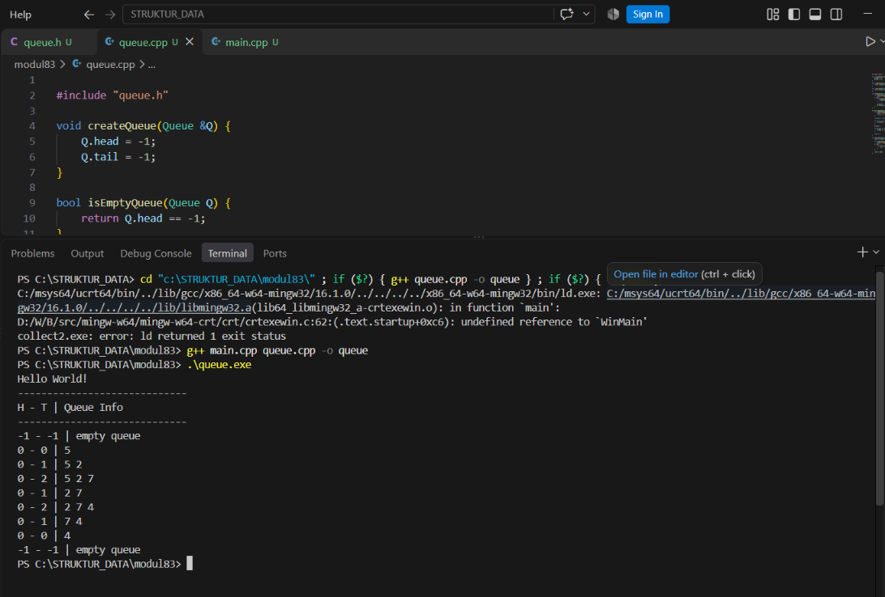
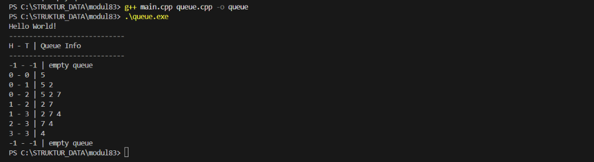
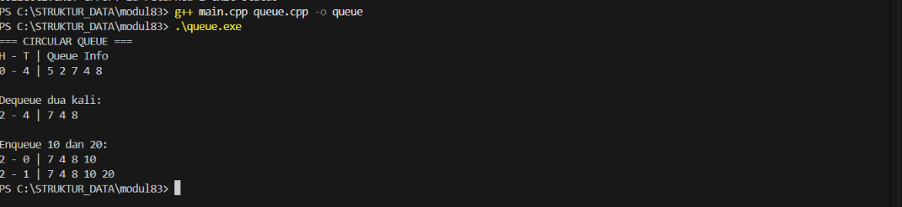

# <h1 align="center">Laporan Praktikum Modul 8 - QUEUE</h1>

<p align="center">Ewaldo Ardiansyah Widyadhana - 109082500008</p>

## Dasar Teori

Queue merupakan salah satu struktur data yang menggunakan prinsip FIFO (First In First Out), yaitu data yang pertama kali masuk akan menjadi data yang pertama kali keluar. Queue memiliki dua penunjuk utama, yaitu head untuk menunjukkan posisi data paling depan dan tail untuk menunjukkan posisi data paling belakang. Dalam implementasinya menggunakan array, Queue memiliki kapasitas penyimpanan tertentu dan setiap data disimpan berdasarkan indeks.

Abstract Data Type (ADT) merupakan konsep struktur data yang menjelaskan jenis data serta operasi yang dapat dilakukan terhadap data tersebut. Pada Queue, terdapat beberapa operasi dasar, yaitu enqueue untuk menambahkan data, dequeue untuk menghapus data, isEmpty untuk memeriksa apakah Queue kosong, dan isFull untuk memeriksa apakah Queue penuh.

Implementasi Queue menggunakan array dapat dilakukan dengan tiga alternatif. Alternatif pertama menggunakan head diam dan tail bergerak, sehingga data akan bergeser ke kiri ketika dilakukan penghapusan. Alternatif kedua menggunakan head dan tail yang sama-sama bergerak tanpa menggeser data. Sedangkan alternatif ketiga menggunakan Circular Queue, yaitu mekanisme Queue yang memungkinkan head dan tail bergerak secara melingkar sehingga ruang kosong pada array dapat digunakan kembali.

Dalam praktikum ini, bahasa pemrograman C++ digunakan untuk mengimplementasikan ADT Queue dengan memanfaatkan array, struct, fungsi, percabangan, dan perulangan. Program dibagi menjadi tiga file, yaitu queue.h sebagai deklarasi, queue.cpp sebagai implementasi fungsi, dan main.cpp sebagai program utama untuk menjalankan serta menguji operasi Queue.

## Guided 1

### 1. QUEUE HEAD

```C++
#ifndef QUEUE_H
#define QUEUE_H

#include <iostream>
#include <string>
using namespace std;

struct Node
{
    string nama;
    Node *next;
};

struct queue
{
    Node *head, *tail;
};

void CreateQueue(queue &Q);
bool isEmpty(queue Q);
bool isFull(queue Q);
void enQueue(queue &Q, const string &nama);
void deQueue(queue &Q);
void viewQueue(queue Q);
void clearQueue(queue &Q);

#endif


```

### 2. IMPLEMENTASI QUEUE

```C++
#include "queue.h"

void CreateQueue(queue &Q)
{
    Q.head = Q.tail = nullptr;
}

bool isEmpty(queue Q)
{
    return Q.head == nullptr && Q.tail == nullptr;
}

bool isFull(queue Q)
{
    int maxQueue = 20;
    int counter = 0;
    Node *nodeBantu = Q.head;

    while (nodeBantu != Q.tail)
    {
        counter++;
        nodeBantu ->next;
    }

    return counter >= maxQueue;
}

void enQueue(queue &Q, const string &nama)
{
    if (isEmpty(Q)){
        Node *nodeBaru = new Node{nama, nullptr};
        Q.head = Q.tail = nodeBaru;
    }else 
    {
        Node *nodeBaru = new Node{nama, nullptr};
        Q.tail->next = nodeBaru;
        Q.tail = nodeBaru;
    }
}

void deQueue(queue &Q)
{
    if (isEmpty(Q))
    {
        cout <<"Queue kosong";
    }
    else
    {
        Node *nodeHapus = Q.head;
        Q.head = Q.head ->next;
        delete nodeHapus;
    }
}

void viewQueue(queue Q)
{
    if (isEmpty(Q))
    {
        cout <<"Queue kosong";
    }
    else
    {
        Node *nodeBantu = Q.head;

        while (nodeBantu != nullptr)
        {
            cout << "Nama : " << nodeBantu->nama << endl;
            nodeBantu = nodeBantu->next;
        }
    }
}

void clearQueue(queue &Q)
{
    if (isEmpty(Q))
    {
        cout <<"Queue kososng";
    }else {
        Node *nodeHapus = Q.head;

        while(nodeHapus != nullptr)
        {
            nodeHapus = nodeHapus->next;
            deQueue(Q);
        }

    }
}

```

### 3. main.cpp

```C++
#include "queue.h"
#include <iostream>
using namespace std;

int main()
{
    queue Q;
    CreateQueue(Q);

    enQueue(Q, "Gilar");
    enQueue(Q, "Aflah");
    enQueue(Q, "Aedi");
    enQueue(Q, "Fatihir");
    enQueue(Q, "Kevin");
    enQueue(Q, "Zulfa");
    cout << endl;

    cout << "--- Isi Queue Setelah enQueue ---"<< endl;
    viewQueue(Q);

    clearQueue(Q);
    return 0;
}
```

## Guided 2

### 1. QUEUE HEAD

```C++
#ifndef QUEUE_H
#define QUEUE_H

#include <iostream>
using namespace std;

const int MAKSIMAL = 5;

struct queue {
    string nama[MAKSIMAL];
    int head;
    int tail;
};

void CreateQueue(queue &Q);
bool isEmpty(queue Q);
bool isFull(queue Q);
void enQueue(queue &Q, const string &nama);
void deQueue(queue &Q);
void viewQueue(queue Q);
void clearQueue(queue &Q);

#endif

```

### 2. IMPLEMENTASI QUEUE

```C++
#include "queue.h"
#include <iostream>

using namespace std;

// NOTE : 
// Implementasi 1 = head diam, tail bergerak (Queue Linear Statis, kerana head nya tetap diam)
// Implementasi 2 = head bergerak, tail bergerak (Queue Linear Dinamis, karena head & tail nya sama-sama bergerak)
// Implementasi 3 = head dan tail berputar (Queue Circular, karena jika udh mentok tapi masih ada space, diputar sehingga tail bisa ada didepan head)

bool isEmpty(queue Q){
    if(Q.head == -1 && Q.tail == -1){
        return true;
    } else {
        return false;
    }
}

//isFull implmenetasi 1 & 2
bool isFull(queue Q){
    if(Q.tail == MAKSIMAL - 1){
        return true;
    } else {
        return false;
    }
}

// //isFull implementasi 3
// bool isFull(queue Q){
//     if((Q.tail + 1) % MAKSIMAL == Q.head){
//         return true;
//     } else {
//         return false;
//     }
// }

void CreateQueue(queue &Q){ //terbentuk queue dengan head = -1 dan tail = -1 
    Q.head = -1;
    Q.tail = -1;
}
 

//enqueue implementasi 1 & 2
void enQueue(queue &Q, string nama){
    if(isFull(Q) == true){
        cout << "Queue sudah penuh!" << endl;
    } else {
        if(isEmpty(Q) == true){
            Q.head = Q.tail = 0;
        } else {
            Q.tail++;
        }
        Q.nama[Q.tail] = nama;
        cout << "nama " << nama << " berhasil ditambahkan kedalam queue!" << endl;
    }
}

// //enQueue implementasi 3
// void enQueue(queue &Q, string nama){
//     if(isFull(Q) == true){
//         cout << "Queue sudah penuh!" << endl;
//     } else {
//         if(isEmpty(Q) == true){
//             Q.head = Q.tail = 0;
//         } else {
//             Q.tail = (Q.tail + 1) % MAKSIMAL; // bergerak melingkar
//         }
//         Q.nama[Q.tail] = nama;
//         cout << "nama " << nama << " berhasil ditambahkan kedalam queue!" << endl;
//     }
// }

//dequeue implementasi 1
void deQueue(queue &Q){
    if(isEmpty(Q) == true){
        cout << "Queue kosong!" << endl;
    } else {
        cout << "Mengahapus data " << Q.nama[Q.head] << "..." << endl;
        for(int i = 0; i < Q.tail; i++){
            Q.nama[i] =  Q.nama[i+1];
        }
        Q.tail--;
        if(Q.tail < 0){ //kalo semua isi queue nya udh dikeluarin, set head & tail ke -1
            Q.head = -1;
            Q.tail = -1;
        }
    }
}

// //dequeue implementasi 2
// void deQueue(queue &Q){
//     if(isEmpty(Q) == true){
//         cout << "Queue kosong!" << endl;
//     } else {
//         cout << "Mengahapus data " << Q.nama[Q.head] << "..." << endl;
//         Q.head++;
//         if(Q.head > Q.tail){ //kalo elemennya udh abis (head akan lebih 1 dari tail), maka reset ulang head & tail ke -1
//             Q.head = -1;
//             Q.tail = -1;
//         }
//     }
// }

// //deQueue implementasi 3
// void deQueue(queue &Q){
//     if(isEmpty(Q) == true){
//         cout << "Queue kosong!" << endl;
//     } else {
//         cout << "Mengahapus data " << Q.nama[Q.head] << "..." << endl;
//         if(Q.head == Q.tail){ //kalo elemennya tinggal 1, langsungkan saja head & tail nya reset ke -1
//             Q.head = -1;
//             Q.tail = -1;
//         } else {
//             Q.head = (Q.head + 1) % MAKSIMAL; // bergerak melingkar
//         }
//     }
// }

//viewQueue implementasi 1 & 2
void viewQueue(queue Q){
    if(isEmpty(Q) == true){
        cout << "Queue kosong!" << endl;
    } else {
        for(int i = Q.head; i <= Q.tail; i++){
            cout << i -  Q.head + 1 << ". " << Q.nama[i] << endl;
        }
    }
    cout << endl;
}

// //viewQueue implementasi 3
// void viewQueue(queue Q){
//     if(isEmpty(Q) == true){
//         cout << "Queue kosong!" << endl;
//     } else {
//         int i = Q.head;
//         int count = 1;
//         while(true){
//             cout << count << ". " << Q.nama[i] << endl;
//             if(i == Q.tail){
//                 break;
//             }
//             i = (i + 1) % MAKSIMAL;
//             count++;
//         }   
//     }
// }
```

### 3. main.cpp

```C++
#include "queue.h"
#include <iostream>

using namespace std;

int main(){
    queue Q;

    CreateQueue(Q);
    enQueue(Q, "Dimas");
    enQueue(Q, "Arvin");
    enQueue(Q, "Rizal");
    enQueue(Q, "Hafizh");
    enQueue(Q, "Fathur");
    enQueue(Q, "Daffa");
    cout << endl;

    cout << "--- Isi Queue Setelah enQueue ---" << endl;
    viewQueue(Q);
    cout << endl;

    deQueue(Q);
    deQueue(Q);
    deQueue(Q);
    deQueue(Q);
    // deQueue(Q);
    // deQueue(Q);
    cout << endl;

    cout << "--- Isi Queue Setelah deQueue ---" << endl;
    viewQueue(Q);

    return 0;
}
```


## Unguided

### 1. (isi dengan soal unguided 1)

```C++

#ifndef QUEUE_H
#define QUEUE_H

#include <iostream>
using namespace std;

typedef int infotype;

struct Queue {
    infotype info[5];
    int head;
    int tail;
};

void createQueue(Queue &Q);
bool isEmptyQueue(Queue Q);
bool isFullQueue(Queue Q);
void enqueue(Queue &Q, infotype x);
infotype dequeue(Queue &Q);
void printInfo(Queue Q);

#endif

```
File queue.h merupakan file header yang berisi deklarasi atau rancangan fungsi Queue. Jadi, file ini menentukan apa saja fungsi yang akan digunakan, tetapi belum menjelaskan bagaimana fungsi tersebut bekerja.


### 2. (IMPLEMENTASI)Alternatif pertama

```C++

#include "queue.h"

void createQueue(Queue &Q) {
    Q.head = -1;
    Q.tail = -1;
}

bool isEmptyQueue(Queue Q) {
    return Q.head == -1;
}

bool isFullQueue(Queue Q) {
    return Q.tail == 4;
}

void enqueue(Queue &Q, infotype x) {
    if (isFullQueue(Q)) {
        cout << "Queue penuh!" << endl;
    } else {
        if (isEmptyQueue(Q)) {
            Q.head = 0;
        }

        Q.tail++;
        Q.info[Q.tail] = x;
    }
}

infotype dequeue(Queue &Q) {
    if (isEmptyQueue(Q)) {
        cout << "Queue kosong!" << endl;
        return -1;
    }

    infotype x = Q.info[Q.head];

    for (int i = 0; i < Q.tail; i++) {
        Q.info[i] = Q.info[i + 1];
    }

    Q.tail--;

    if (Q.tail == -1) {
        Q.head = -1;
    }

    return x;
}

void printInfo(Queue Q) {
    cout << Q.head << " - " << Q.tail << " | ";

    if (isEmptyQueue(Q)) {
        cout << "empty queue";
    } else {
        for (int i = Q.head; i <= Q.tail; i++) {
            cout << Q.info[i] << " ";
        }
    }

    cout << endl;
}
```
Alternatif 1 adalah metode Queue menggunakan array dengan posisi head tetap berada di indeks 0 selama Queue berisi data, sedangkan tail bergerak ke kanan ketika ada penambahan data.Jika dilakukan penghapusan (dequeue), data yang tersisa akan digeser ke kiri agar posisi head tetap di indeks 0.


### 2. (IMPLEMENTASI)Alternatif kedua

```C++

#include "queue.h"

void createQueue(Queue &Q) {
    Q.head = -1;
    Q.tail = -1;
}

bool isEmptyQueue(Queue Q) {
    return Q.head == -1;
}

bool isFullQueue(Queue Q) {
    return Q.tail == 4;
}

void enqueue(Queue &Q, infotype x) {
    if (isFullQueue(Q)) {
        cout << "Queue penuh!" << endl;
    } else {
        if (isEmptyQueue(Q)) {
            Q.head = 0;
            Q.tail = 0;
        } else {
            Q.tail++;
        }

        Q.info[Q.tail] = x;
    }
}

infotype dequeue(Queue &Q) {
    if (isEmptyQueue(Q)) {
        cout << "Queue kosong!" << endl;
        return -1;
    }

    infotype x = Q.info[Q.head];

    if (Q.head == Q.tail) {
        Q.head = -1;
        Q.tail = -1;
    } else {
        Q.head++;
    }

    return x;
}

void printInfo(Queue Q) {
    cout << Q.head << " - " << Q.tail << " | ";

    if (isEmptyQueue(Q)) {
        cout << "empty queue";
    } else {
        for (int i = Q.head; i <= Q.tail; i++) {
            cout << Q.info[i] << " ";
        }
    }

    cout << endl;
}
```
Alternatif 2 merupakan Queue menggunakan array dengan posisi head dan tail sama-sama bergerak.Berbeda dengan Alternatif 1, ketika data dihapus, elemen lainnya tidak digeser. Head langsung berpindah ke indeks berikutnya.


### 2. (IMPLEMENTASI)Alternatif ketiga

```C++

#include "queue.h"

void createQueue(Queue &Q) {
    Q.head = -1;
    Q.tail = -1;
}

bool isEmptyQueue(Queue Q) {
    return Q.head == -1;
}

bool isFullQueue(Queue Q) {
    return !isEmptyQueue(Q) &&
           (Q.tail + 1) % 5 == Q.head;
}

void enqueue(Queue &Q, infotype x) {
    if (isFullQueue(Q)) {
        cout << "Queue penuh!" << endl;
    } else {
        if (isEmptyQueue(Q)) {
            Q.head = 0;
            Q.tail = 0;
        } else {
            Q.tail = (Q.tail + 1) % 5;
        }

        Q.info[Q.tail] = x;
    }
}

infotype dequeue(Queue &Q) {
    if (isEmptyQueue(Q)) {
        cout << "Queue kosong!" << endl;
        return -1;
    }

    infotype x = Q.info[Q.head];

    if (Q.head == Q.tail) {
        Q.head = -1;
        Q.tail = -1;
    } else {
        Q.head = (Q.head + 1) % 5;
    }

    return x;
}

void printInfo(Queue Q) {
    cout << Q.head << " - " << Q.tail << " | ";

    if (isEmptyQueue(Q)) {
        cout << "empty queue";
    } else {
        int i = Q.head;

        while (true) {
            cout << Q.info[i] << " ";

            if (i == Q.tail) {
                break;
            }

            i = (i + 1) % 5;
        }
    }

    cout << endl;
}


```
Alternatif 3 merupakan Queue yang menggunakan konsep melingkar atau Circular Queue.Pada metode ini, posisi head dan tail dapat kembali ke indeks 0 setelah mencapai indeks terakhir array.Keuntungan utamanya adalah ruang kosong akibat penghapusan data dapat digunakan kembal


### 3. main.cpp

```C++

#include <iostream>
#include "queue.h"

using namespace std;

int main() {
    Queue Q;
    createQueue(Q);

    cout << "=== CIRCULAR QUEUE ===" << endl;
    cout << "H - T | Queue Info" << endl;

    enqueue(Q, 5);
    enqueue(Q, 2);
    enqueue(Q, 7);
    enqueue(Q, 4);
    enqueue(Q, 8);

    printInfo(Q);

    cout << "\nDequeue dua kali:" << endl;
    dequeue(Q);
    dequeue(Q);
    printInfo(Q);

    cout << "\nEnqueue 10 dan 20:" << endl;
    enqueue(Q, 10);
    printInfo(Q);

    enqueue(Q, 20);
    printInfo(Q);

    return 0;
}

```
File main.cpp merupakan program utama yang digunakan untuk menjalankan seluruh fungsi Queue yang sudah dibuat di queue.cpp.

Kode ini dapat digunakan untuk ketiga alternatif tanpa perlu diubah, selama urutan operasinya sama.


##### Output 1



##### Output 2



##### Output 3




## Kesimpulan

Berdasarkan praktikum ADT Queue menggunakan Array, dapat disimpulkan bahwa Queue merupakan struktur data yang menggunakan prinsip FIFO (First In First Out), yaitu data yang pertama masuk akan menjadi data yang pertama keluar. Dalam implementasinya, digunakan array berkapasitas 5 elemen dengan dua variabel utama, yaitu head sebagai penunjuk data paling depan dan tail sebagai penunjuk data paling belakang.

Pada praktikum ini terdapat tiga alternatif mekanisme Queue. Alternatif 1 menggunakan konsep head diam dan tail bergerak, sehingga setiap penghapusan data akan menyebabkan elemen lainnya bergeser ke kiri. Alternatif 2 menggunakan head dan tail yang sama-sama bergerak tanpa melakukan pergeseran data, tetapi ruang kosong di bagian depan tidak dapat digunakan kembali. Sementara itu, Alternatif 3 menggunakan konsep Circular Queue, yaitu head dan tail dapat berputar kembali ke indeks 0 sehingga penggunaan ruang array menjadi lebih efisien.

Melalui praktikum ini, dapat dipahami cara kerja fungsi enqueue, dequeue, isEmptyQueue, isFullQueue, dan printInfo dalam mengelola data Queue menggunakan bahasa C++. Selain itu, praktikum ini memberikan pemahaman mengenai perbedaan ketiga mekanisme Queue serta pentingnya pengaturan posisi head dan tail agar proses penambahan, penghapusan, dan penggunaan ruang penyimpanan dapat berjalan dengan baik.

## Referensi

[1] Triase. (2020). Diktat Edisi Revisi : STRUKTUR DATA. Medan: UNIVERSTAS ISLAM NEGERI SUMATERA UTARA MEDAN.
<br>[2] Indahyati, Uce., Rahmawati Yunianita. (2020). "BUKU AJAR ALGORITMA DAN PEMROGRAMAN DALAM BAHASA C++". Sidoarjo: Umsida Press. Diakses pada 10 Maret 2024 melalui https://doi.org/10.21070/2020/978-623-6833-67-4.
<br>...
