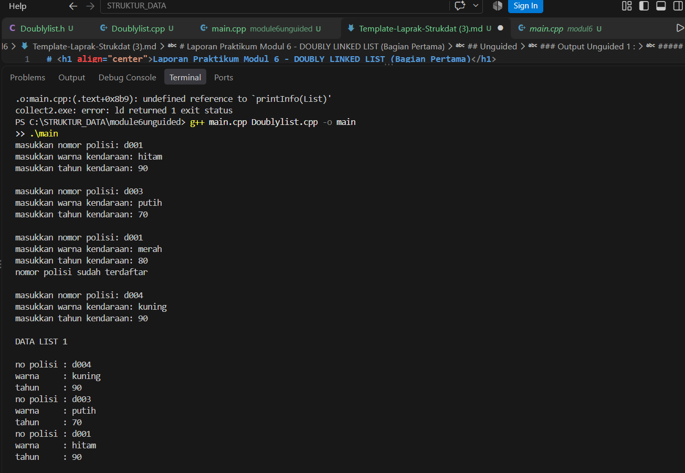

# <h1 align="center">Laporan Praktikum Modul 6 - DOUBLY LINKED LIST (Bagian Pertama)</h1>

<p align="center">Ewaldo Ardiansyah Widyadhana - 109082500008</p>

## Dasar Teori

isi dengan penjelasan dasar teori disertai referensi jurnal (gunakan kurung siku [] untuk pernyataan yang mengambil refernsi dari jurnal).
contoh :
Linked list atau yang disebut juga senarai berantai adalah Salah satu bentuk struktur data yang berisi kumpulan data yang tersusun secara sekuensial, saling bersambungan, dinamis, dan terbatas[1]. Linked list terdiri dari sejumlah node atau simpul yang dihubungkan secara linier dengan bantuan pointer.

## Guided

### 1. headListMakanan

```C++
#ifndef LISTMAKANAN_H
#define LISTMAKANAN_H
#define Nil NULL

#include <iostream>
using namespace std;

struct makanan
{
    string nama;
    string jenis;
    float harga;
    float rating;
};

typedef makanan dataMakanan;

typedef struct node *address;

struct node
{
    dataMakanan isidata;
    address next;
    address prev;
};

struct linkedlist
{
    address first;
    address last;
};

bool isEmpty(linkedlist List);
void createList(linkedlist &List);
address alokasi(string nama, string jenis, float harga, float rating);
void dealokasi(address &node);

void insertFirst(linkedlist &List, address nodeBaru);
void insertLast(linkedlist &List, address nodeBaru);
void insertAfter(linkedlist &List, address nodeBaru, address Prev);
void insertBefore(linkedlist &List, address nodeBaru, address nodeNext);

void printList(linkedlist List);

void updateFirst(linkedlist List);
void updateLast(linkedlist List);
void updateAfter(linkedlist List, address prev);
void updateBefore(linkedlist List, address nodeNext);

// Searching
void findByName(linkedlist List, string nama);
void findByJenis(linkedlist List, string jenis);
void findByMinRating(linkedlist List, float minRating);

// Delete
void deleteFirst(linkedlist &List);
void deleteLast(linkedlist &List);
void deleteAfter(linkedlist &List, address Prev);
void deleteBefore(linkedlist &List, address nodeNext);

void deleteNode(linkedlist &List, address target);
void deleteByName(linkedlist &List, string nama);

#endif
```

### 2. code utama

```C++
#include "listMakanan.h"
#include <iostream>
#include <string>
using namespace std;

bool isEmpty(linkedlist List)
{
    if (List.first == Nil)
    {
        return true;
    }
    else
    {
        return false;
    }
}

void createList(linkedlist &List)
{
    List.first = Nil;
    List.last = Nil;
}

// pembuatan node baru dengan menerapkan manajemen memori
address alokasi(string nama, string jenis, float harga, float rating)
{
    address nodeBaru = new node;
    nodeBaru->isidata.nama = nama;
    nodeBaru->isidata.jenis = jenis;
    nodeBaru->isidata.harga = harga;
    nodeBaru->isidata.rating = rating;
    nodeBaru->next = Nil;
    nodeBaru->prev = Nil;
    return nodeBaru;
}

void dealokasi(address &node)
{
    node->next = Nil;
    node->prev = Nil;
    delete node;
}

void insertFirst(linkedlist &List, address nodeBaru)
{
    if (isEmpty(List))
    {
        List.first = List.last = nodeBaru;
    }
    else
    {
        nodeBaru->next = List.first;
        List.first->prev = nodeBaru;
        List.first = nodeBaru;
    }
    cout << "Node " << nodeBaru->isidata.nama << " berhasil ditambahkan sebagai node pertama list" << endl;
}

void insertLast(linkedlist &List, address nodeBaru)
{
    if (isEmpty(List) == true)
    {
        List.first = List.last = nodeBaru;
    }
    else
    {
        nodeBaru->prev = List.last;
        List.last->next = nodeBaru;
        List.last = nodeBaru;
    }
    cout << "Node " << nodeBaru->isidata.nama << " berhasil ditambahkan sebagai node terakhir list" << endl;
}

void insertAfter(linkedlist &List, address nodeBaru, address nodePrev)
{
    if (isEmpty(List) == true)
    {
        List.first = List.last = nodeBaru;
    }
    else
    {
        if (nodePrev != Nil)
        {
            if (nodePrev == List.last)
            {
                insertLast(List, nodeBaru);
            }
            else
            {
                nodeBaru->next = nodePrev->next;
                nodeBaru->prev = nodePrev;
                (nodePrev->next)->prev = nodeBaru;
                nodePrev->next = nodeBaru;
                cout << "Node " << nodeBaru->isidata.nama << " berhasil ditambahkan setelah node " << nodePrev->isidata.nama << endl;
            }
        }
        else
        {
            cout << "node sebelumnya (nodePrev) tidak valid!" << endl;
        }
    }
}

void insertBefore(linkedlist &List, address nodeBaru, address nodeNext)
{
    if (isEmpty(List) == true)
    {
        List.first = List.last = nodeBaru;
    }
    else
    {
        if (nodeNext != Nil)
        {
            if (nodeNext == List.first)
            {
                insertFirst(List, nodeBaru);
            }
            else
            {
                nodeBaru->next = nodeNext;
                nodeBaru->prev = nodeNext->prev;
                (nodeNext->prev)->next = nodeBaru;
                nodeNext->prev = nodeBaru;
                cout << "Node " << nodeBaru->isidata.nama << " berhasil ditambahkan sebelum node " << nodeNext->isidata.nama << endl;
            }
        }
        else
        {
            cout << "node setelahnya (nodeNext) tidak valid!" << endl;
        }
    }
}

void printList(linkedlist List)
{
    if (isEmpty(List) == true)
    {
        cout << "List kosong!" << endl;
    }
    else
    {
        address nodeBantu = List.first;
        while (nodeBantu != Nil)
        {
            cout << "Nama makanan : " << nodeBantu->isidata.nama << endl;
            cout << "Jenis        : " << nodeBantu->isidata.jenis << endl;
            cout << "Harga        : " << nodeBantu->isidata.harga << endl;
            cout << "Rating       : " << nodeBantu->isidata.rating << endl;
            cout << "-------------------------------" << endl;
            nodeBantu = nodeBantu->next;
        }
    }
}

void updateFirst(linkedlist List)
{
    if (isEmpty(List) == true)
    {
        cout << "List kosong!" << endl;
    }
    else
    {
        cout << "Masukkan update data node pertama : " << endl;
        cout << "Nama makanan : ";
        getline(cin, List.first->isidata.nama);
        cout << "Jenis makanan : ";
        getline(cin, List.first->isidata.jenis);
        cout << "Harga : ";
        cin >> List.first->isidata.harga;
        cout << "Rating : ";
        cin >> List.first->isidata.rating;
        cin.ignore(); // menghapus karakter newline (/n) dari input buffer
        cout << "Data Berhasil Diupdate!" << endl;
        cout << endl;
    }
}

void updateLast(linkedlist List)
{
    if (isEmpty(List) == true)
    {
        cout << "List kosong!" << endl;
    }
    else
    {
        cout << "Masukkan update data node terakhir : " << endl;
        cout << "Nama makanan : ";
        getline(cin, List.last->isidata.nama);
        cout << "Jenis makanan : ";
        getline(cin, List.last->isidata.jenis);
        cout << "Harga : ";
        cin >> List.last->isidata.harga;
        cout << "Rating : ";
        cin >> List.last->isidata.rating;
        cin.ignore(); // menghapus karakter newline (/n) dari input buffer
        cout << "Data Berhasil Diupdate!" << endl;
        cout << endl;
    }
}

void updateAfter(linkedlist List, address nodePrev)
{
    if (isEmpty(List) == true)
    {
        cout << "List kosong!" << endl;
    }
    else
    {
        if (nodePrev != Nil && nodePrev->next != Nil)
        {
            address nodeBantu = nodePrev->next;
            cout << "masukkan update data node setelah node " << nodePrev->isidata.nama << " : " << endl;
            cout << "Nama makanan : ";
            getline(cin, nodeBantu->isidata.nama);
            cout << "Jenis makanan : ";
            getline(cin, nodeBantu->isidata.jenis);
            cout << "Harga : ";
            cin >> nodeBantu->isidata.harga;
            cout << "Rating : ";
            cin >> nodeBantu->isidata.rating;
            cin.ignore(); // menghapus karakter newline (/n) dari input buffer
            cout << "Data Berhasil Diupdate!" << endl;
            cout << endl;
        }
        else
        {
            cout << "Node sebelumnya (nodePrev) tidak valid!" << endl;
        }
    }
}

void updateBefore(linkedlist List, address nodeNext)
{
    if (isEmpty(List) == true)
    {
        cout << "List kosong!" << endl;
    }
    else
    {
        if (nodeNext != Nil && nodeNext->prev != Nil)
        {
            address nodeBantu = nodeNext->prev;
            cout << "masukkan update data node sebelum node " << nodeNext->isidata.nama << " : " << endl;
            cout << "Nama makanan : ";
            getline(cin, nodeBantu->isidata.nama);
            cout << "Jenis makanan : ";
            getline(cin, nodeBantu->isidata.jenis);
            cout << "Harga : ";
            cin >> nodeBantu->isidata.harga;
            cout << "Rating : ";
            cin >> nodeBantu->isidata.rating;
            cin.ignore(); // menghapus karakter newline (/n) dari input buffer
            cout << "Data Berhasil Diupdate!" << endl;
            cout << endl;
        }
        else
        {
            cout << "Node sebelumnya (prev) tidak valid!" << endl;
        }
    }
}

// SEARCHING
void findByName(linkedlist List, string nama)
{
    if (isEmpty(List))
    {
        cout << "List kosong!" << endl;
        return;
    }
    address p = List.first;
    while (p != Nil)
    {
        if (p->isidata.nama == nama)
        {
            cout << "Ditemukan (berdasarkan nama):" << endl;
            cout << "Nama makanan : " << p->isidata.nama << endl;
            cout << "Jenis        : " << p->isidata.jenis << endl;
            cout << "Harga        : " << p->isidata.harga << endl;
            cout << "Rating       : " << p->isidata.rating << endl;
            return;
        }
        p = p->next;
    }
    cout << "Data dengan nama \"" << nama << "\" tidak ditemukan." << endl;
}

void findByJenis(linkedlist List, string jenis)
{
    if (isEmpty(List))
    {
        cout << "List kosong!" << endl;
        return;
    }
    address p = List.last;
    while (p != Nil)
    {
        if (p->isidata.jenis == jenis)
        {
            cout << "Ditemukan (berdasarkan jenis):" << endl;
            cout << "Nama makanan : " << p->isidata.nama << endl;
            cout << "Jenis        : " << p->isidata.jenis << endl;
            cout << "Harga        : " << p->isidata.harga << endl;
            cout << "Rating       : " << p->isidata.rating << endl;
            return;
        }
        p = p->prev;
    }
    cout << "Data dengan jenis \"" << jenis << "\" tidak ditemukan." << endl;
}

void findByMinRating(linkedlist List, float minRating)
{
    if (isEmpty(List))
    {
        cout << "List kosong!" << endl;
        return;
    }
    address p = List.first;
    while (p != Nil)
    {
        if (p->isidata.rating >= minRating)
        {
            cout << "Ditemukan (rating >= " << minRating << "):" << endl;
            cout << "Nama makanan : " << p->isidata.nama << endl;
            cout << "Jenis        : " << p->isidata.jenis << endl;
            cout << "Harga        : " << p->isidata.harga << endl;
            cout << "Rating       : " << p->isidata.rating << endl;
            return;
        }
        p = p->next;
    }
    cout << "Tidak ada data dengan rating >= " << minRating << "." << endl;
}

// DELETE
void deleteFirst(linkedlist &List)
{
    if (isEmpty(List) == true)
    {
        cout << "List kosong! Tidak ada node yang dihapus." << endl;
        return;
    }
    address pDel = List.first;
    if (List.first == List.last)
    {
        List.first = List.last = Nil;
    }
    else
    {
        List.first = pDel->next;
        List.first->prev = Nil;
        pDel->next = Nil;
    }
    pDel->prev = Nil;
    cout << "Node " << pDel->isidata.nama << " berhasil dihapus dari posisi pertama." << endl;
    dealokasi(pDel);
}

void deleteLast(linkedlist &List)
{
    if (isEmpty(List) == true)
    {
        cout << "List kosong! Tidak ada node yang dihapus." << endl;
        return;
    }
    address pDel = List.last;
    if (List.first == List.last)
    {
        List.first = List.last = Nil;
    }
    else
    {
        List.last = pDel->prev;
        List.last->next = Nil;
        pDel->prev = Nil;
    }
    pDel->next = Nil;
    cout << "Node " << pDel->isidata.nama << " berhasil dihapus dari posisi terakhir." << endl;
    dealokasi(pDel);
}

void deleteAfter(linkedlist &List, address Prev)
{
    if (isEmpty(List) == true)
    {
        cout << "List kosong! Tidak ada node yang dihapus." << endl;
        return;
    }
    if (Prev == Nil || Prev->next == Nil)
    {
        cout << "Node sebelumnya (Prev) tidak valid atau tidak ada node setelahnya!" << endl;
        return;
    }
    if (Prev->next == List.last)
    {
        deleteLast(List);
        return;
    }
    address pDel = Prev->next;
    Prev->next = pDel->next;
    pDel->next->prev = Prev;
    pDel->next = Nil;
    pDel->prev = Nil;
    cout << "Node " << pDel->isidata.nama << " berhasil dihapus setelah node " << Prev->isidata.nama << "." << endl;
    dealokasi(pDel);
}

void deleteBefore(linkedlist &List, address nodeNext)
{
    if (isEmpty(List) == true)
    {
        cout << "List kosong! Tidak ada node yang dihapus." << endl;
        return;
    }
    if (nodeNext == Nil || nodeNext->prev == Nil)
    {
        cout << "Node setelahnya (nodeNext) tidak valid atau tidak ada node sebelumnya!" << endl;
        return;
    }
    if (nodeNext->prev == List.first)
    {
        deleteFirst(List);
        return;
    }
    address pDel = nodeNext->prev;
    nodeNext->prev = pDel->prev;
    pDel->prev->next = nodeNext;
    pDel->next = Nil;
    pDel->prev = Nil;
    cout << "Node " << pDel->isidata.nama << " berhasil dihapus sebelum node " << nodeNext->isidata.nama << "." << endl;
    dealokasi(pDel);
}

void deleteNode(linkedlist &List, address target)
{
    if (isEmpty(List) == true || target == Nil)
    {
        cout << "Target tidak valid atau list kosong!" << endl;
        return;
    }
    if (target == List.first)
    {
        deleteFirst(List);
    }
    else if (target == List.last)
    {
        deleteLast(List);
    }
    else
    {
        address L = target->prev;
        address R = target->next;
        L->next = R;
        R->prev = L;
        target->next = Nil;
        target->prev = Nil;
        cout << "Node " << target->isidata.nama << " berhasil dihapus dari tengah list." << endl;
        dealokasi(target);
    }
}

void deleteByName(linkedlist &List, string nama)
{
    if (isEmpty(List))
    {
        cout << "List kosong! Tidak ada node yang dihapus." << endl;
        return;
    }

    address target = List.first;
    while (target != Nil && target->isidata.nama != nama)
    {
        target = target->next;
    }
    if (target == Nil)
    {
        cout << "Node dengan nama \"" << nama << "\" tidak ditemukan." << endl;
        return;
    }

    deleteNode(List, target);
    cout << "Node dengan nama \"" << nama << "\" telah dihapus dan didealokasi." << endl;
}
```

### 3. mian.cpp

```C++
#include "listMakanan.h"
#include <iostream>

using namespace std;

int main()
{
    linkedlist List;
    address nodeA, nodeB, nodeC, nodeD, nodeE = Nil;
    createList(List);

    dataMakanan dtMakanan;

    nodeA = alokasi("Nasi Rames", "Makanan Berat", 10000, 8.5);
    nodeB = alokasi("Ayam Geprek", "Makanan Berat", 13000, 9.0);
    nodeC = alokasi("Risol Mayo", "Makanan Ringan", 3500, 8.8);
    nodeD = alokasi("Mie Ayam", "Makanan Berat", 15000, 9.9);
    nodeE = alokasi("Donat", "Makanan Ringan", 2000, 7.7);

    insertFirst(List, nodeD);
    insertLast(List, nodeE);
    insertAfter(List, nodeA, nodeD);
    insertBefore(List, nodeC, nodeE);
    insertLast(List, nodeB);
    cout << endl;

    // D - A - C - E - B
    cout << "--- Isi List Setelah Insert ---" << endl;
    printList(List);
    cout << endl;

    updateFirst(List);
    updateLast(List);
    updateBefore(List, nodeC);
    updateAfter(List, nodeA);

    cout << "--- Isi List Setelah Update ---" << endl;
    printList(List);

    cout << endl;

    findByName(List, "Nasgor");
    findByMinRating(List, 9.0);

    deleteByName(List, "Nasgor");
    deleteFirst(List);
    deleteBefore(List, nodeE);

    cout << endl
         << "--- Isi List Setelah Delete ---" << endl;
    printList(List);

    return 0;
}
```


## Unguided

### 1. 

Header Doublylist

```C++
#ifndef DOUBLYLIST_H_INCLUDED
#define DOUBLYLIST_H_INCLUDED

#include <iostream>
#include <string>

using namespace std;

// Definisi tipe data
struct kendaraan {
    string nopol;
    string warna;
    int thnBuat;
};

typedef kendaraan infotype;
typedef struct ElmList *address;

struct ElmList {
    infotype info;
    address next;
    address prev;
};

struct List {
    address First;
    address Last;
};

// Prototipe Fungsi dan Prosedur dasar
void CreateList(List &L);
address alokasi(infotype x);
void dealokasi(address &P);
void printInfo(List L);
void insertLast(List &L, address P);

// Fungsi pencarian (Nomor 2)
address findElm(List L, infotype x);

// Prosedur penghapusan (Nomor 3)
void deleteFirst(List &L, address &P);
void deleteLast(List &L, address &P);
void deleteAfter(address Prec, address &P);

#endif // DOUBLYLIST_H_INCLUDED
```

### 2. 

Code Utama Doublylist

```C++
#include "Doublylist.h"

void CreateList(List &L) {
    L.First = nullptr;
    L.Last = nullptr;
}

address alokasi(infotype x) {
    address P = new ElmList;
    if (P != nullptr) {
        P->info = x;
        P->next = nullptr;
        P->prev = nullptr;
    }
    return P;
}

void dealokasi(address &P) {
    delete P;
    P = nullptr;
}

void insertLast(List &L, address P) {
    if (L.First == nullptr && L.Last == nullptr) {
        L.First = P;
        L.Last = P;
    } else {
        P->prev = L.Last;
        L.Last->next = P;
        L.Last = P;
    }
}

void printInfo(List L) {
    address P = L.First;
    while (P != nullptr) {
        cout << "no polisi : " << P->info.nopol << endl;
        cout << "warna     : " << P->info.warna << endl;
        cout << "tahun     : " << P->info.thnBuat << endl;
        P = P->next;
    }
}

address findElm(List L, infotype x) {
    address P = L.First;
    while (P != nullptr) {
        if (P->info.nopol == x.nopol) {
            return P;
        }
        P = P->next;
    }
    return nullptr;
}

void deleteFirst(List &L, address &P) {
    if (L.First != nullptr) {
        P = L.First;
        if (L.First == L.Last) {
            L.First = nullptr;
            L.Last = nullptr;
        } else {
            L.First = L.First->next;
            L.First->prev = nullptr;
            P->next = nullptr;
        }
    } else {
        P = nullptr;
    }
}

void deleteLast(List &L, address &P) {
    if (L.Last != nullptr) {
        P = L.Last;
        if (L.First == L.Last) {
            L.First = nullptr;
            L.Last = nullptr;
        } else {
            L.Last = L.Last->prev;
            L.Last->next = nullptr;
            P->prev = nullptr;
        }
    } else {
        P = nullptr;
    }
}

void deleteAfter(address Prec, address &P) {
    if (Prec != nullptr && Prec->next != nullptr) {
        P = Prec->next;
        Prec->next = P->next;
        if (P->next != nullptr) {
            P->next->prev = Prec;
        }
        P->next = nullptr;
        P->prev = nullptr;
    } else {
        P = nullptr;
    }
}
```

### 3.

main.cpp

```C++
#include <iostream>
#include "Doublylist.h"

using namespace std;

// Fungsi pembantu untuk insertFirst sesuai urutan tumpukan pada output contoh
void insertFirst(List &L, address P) {
    if (L.First == nullptr && L.Last == nullptr) {
        L.First = P;
        L.Last = P;
    } else {
        P->next = L.First;
        L.First->prev = P;
        L.First = P;
    }
}

int main() {
    List L;
    CreateList(L);
    infotype data;
    address P;

    // --- BAGIAN 1: Input Data Kendaraan ---
    // Input 1
    cout << "masukkan nomor polisi: ";
    cin >> data.nopol;
    cout << "masukkan warna kendaraan: ";
    cin >> data.warna;
    cout << "masukkan tahun kendaraan: ";
    cin >> data.thnBuat;
    P = alokasi(data);
    insertFirst(L, P);
    cout << endl;

    // Input 2
    cout << "masukkan nomor polisi: ";
    cin >> data.nopol;
    cout << "masukkan warna kendaraan: ";
    cin >> data.warna;
    cout << "masukkan tahun kendaraan: ";
    cin >> data.thnBuat;
    P = alokasi(data);
    insertFirst(L, P);
    cout << endl;

    // Input 3 (Uji coba nomor polisi duplikat)
    cout << "masukkan nomor polisi: ";
    cin >> data.nopol;
    cout << "masukkan warna kendaraan: ";
    cin >> data.warna;
    cout << "masukkan tahun kendaraan: ";
    cin >> data.thnBuat;
    if (findElm(L, data) != nullptr) {
        cout << "nomor polisi sudah terdaftar" << endl;
    } else {
        P = alokasi(data);
        insertFirst(L, P);
    }
    cout << endl;

    // Input 4
    cout << "masukkan nomor polisi: ";
    cin >> data.nopol;
    cout << "masukkan warna kendaraan: ";
    cin >> data.warna;
    cout << "masukkan tahun kendaraan: ";
    cin >> data.thnBuat;
    P = alokasi(data);
    insertFirst(L, P);
    cout << endl;

    // Menampilkan isi List
    cout << "DATA LIST 1" << endl << endl;
    printInfo(L);
    cout << endl;

    // --- BAGIAN 2: Cari Elemen (Soal No. 2) ---
    infotype cariData;
    cout << "Masukkan Nomor Polisi yang dicari  : ";
    cin >> cariData.nopol;
    
    address found = findElm(L, cariData);
    if (found != nullptr) {
        cout << endl;
        cout << "Nomor Polisi : " << found->info.nopol << endl;
        cout << "Warna        : " << found->info.warna << endl;
        cout << "Tahun        : " << found->info.thnBuat << endl;
    } else {
        cout << "Data tidak ditemukan." << endl;
    }
    cout << endl;

    // --- BAGIAN 3: Hapus Elemen (Soal No. 3) ---
    infotype hapusData;
    cout << "Masukkan Nomor Polisi yang akan dihapus : ";
    cin >> hapusData.nopol;

    address target = findElm(L, hapusData);
    address deletedNode = nullptr;

    if (target != nullptr) {
        if (target == L.First) {
            deleteFirst(L, deletedNode);
        } else if (target == L.Last) {
            deleteLast(L, deletedNode);
        } else {
            deleteAfter(target->prev, deletedNode);
        }

        if (deletedNode != nullptr) {
            cout << "Data dengan nomor polisi " << deletedNode->info.nopol << " berhasil dihapus." << endl;
            dealokasi(deletedNode);
        }
    } else {
        cout << "Data tidak ditemukan." << endl;
    }

    cout << endl;
    cout << "DATA LIST 1" << endl << endl;
    printInfo(L);

    return 0;
}
```

### Output Unguided 1 :

##### Output 1



Program ini terdiri dari tiga file utama yang saling terhubung untuk membentuk ADT Doubly Linked List kasus kendaraan. File pertama adalah Doublylist.h yang berfungsi untuk mendeklarasikan struktur data seperti kendaraan, ElmList, dan List, serta memuat seluruh prototipe fungsi dan prosedur seperti CreateList, alokasi, insertLast, pencarian, hingga prosedur penghapusan. File kedua yaitu Doublylist.cpp berisi implementasi atau penjabaran kode logika dari seluruh fungsi dan prosedur yang telah dideklarasikan di file header tersebut, mulai dari pengelolaan memori hingga pengaturan pointer next dan prev. File terakhir adalah main.cpp yang bertindak sebagai program utama untuk mengeksekusi sistem, menangani input data kendaraan dari pengguna, melakukan validasi nomor polisi agar tidak duplikat, menampilkan daftar data, serta menguji fitur pencarian dan penghapusan elemen. Ketiga file ini dikompilasi bersama-sama agar program manajemen data kendaraan dapat berjalan secara utuh sesuai dengan modul praktikum.

## Kesimpulan

Kesimpulannya, program ADT Doubly Linked List kasus kendaraan ini dibagi menjadi tiga bagian utama yang saling melengkapi. File Doublylist.h berfungsi untuk mendeklarasikan struktur data dan prototipe fungsi/prosedur, file Doublylist.cpp berisi implementasi logika dari fungsi-fungsi tersebut, dan file main.cpp berperan sebagai program utama untuk menjalankan sistem, mengelola input data pengguna, melakukan validasi, serta menguji fitur pencarian serta penghapusan data.   

## Referensi

[1] Triase. (2020). Diktat Edisi Revisi : STRUKTUR DATA. Medan: UNIVERSTAS ISLAM NEGERI SUMATERA UTARA MEDAN.
<br>[2] Indahyati, Uce., Rahmawati Yunianita. (2020). "BUKU AJAR ALGORITMA DAN PEMROGRAMAN DALAM BAHASA C++". Sidoarjo: Umsida Press. Diakses pada 10 Maret 2024 melalui https://doi.org/10.21070/2020/978-623-6833-67-4.
<br>...
